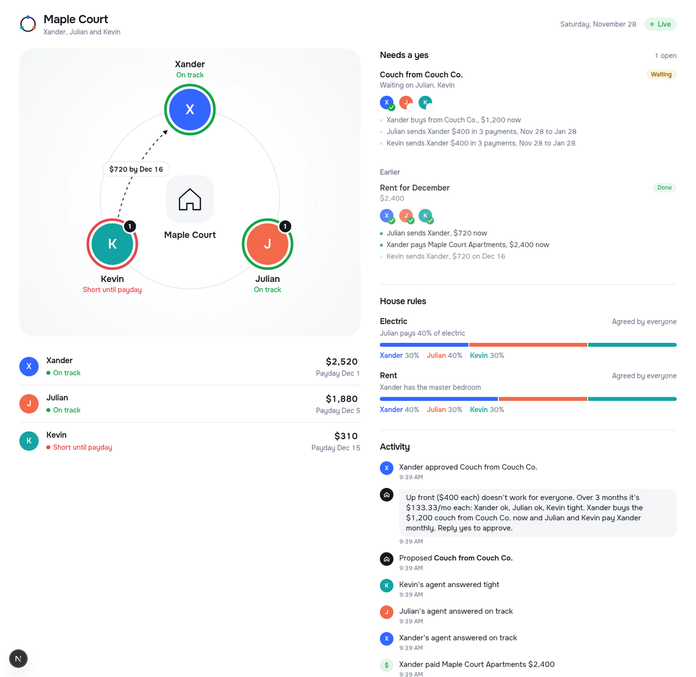

<p align="center">
  
</p>

<p align="center"><b>The AI roommate that keeps the house's money fair, in the group chat you already have.</b></p>

House Rules is a team of AI agents that lives in your roommates' group chat and private DMs. Tell it how your house works ("Xander has the master, so rent is 40/30/30") and it splits every bill by those rules, times each payment to each person's payday, and answers "can we afford a $1,200 couch?" without anyone revealing their balance. Then it actually moves the money through the bank, but only after the right people reply yes.

There's no app to download and no spreadsheet to keep up. The group chat is the interface.

<p align="center">
  
</p>

## The problem

Living with roommates means sharing money with people whose finances you can't see. Rent is due on the 1st but one roommate gets paid on the 15th. Someone fronts the money, someone forgets, and an IOU turns into resentment. Apps like Splitwise track who owes what, but they don't know whether anyone can actually pay, and they never move the money. Asking "can everyone afford this?" in the group chat means someone has to admit they can't.

## What House Rules does

| In the group chat | In your private DM | Behind the scenes |
| --- | --- | --- |
| Splits rent and utilities by the house's rules | Your own agent knows your accounts, payday, subscriptions and goals | **Code does every number**; the LLM only explains |
| Sets new house rules by vote ("rent should be 40/30/30") | Tells you why you're tight, in your own numbers | An **auditor** blocks any number a tool didn't produce, and anyone's private figures |
| Answers "can we afford X?" with ok / tight / no per person | Remembers your cushion, savings goal and fronting cap | A **treasurer** is the only part that can move money, and only after every required yes |
| Proposes a plan: who pays, who fronts, when it's repaid | Approve or decline privately with a yes or 👍 | Scheduled paybacks run on payday automatically |

**Example: rent day.** Rent is $2,400, split 40/30/30 because Xander has the master bedroom. Kevin has $310 until his payday on the 15th.

1. The house agent asks each personal agent whether its roommate can cover their share. Kevin's agent answers only "no, can pay Dec 15"; his balance never reaches the group.
2. The house proposes that Julian fronts Kevin's $720 now and Kevin auto-repays him on Dec 16. Xander was skipped as a fronter because he told his agent not to front more than $500.
3. Kevin's DM explains why, in his own numbers. Julian's DM asks him to agree to front.
4. Everyone replies yes. Money moves through the bank, the dashboard and bank app update, and on Dec 16 the payback runs on its own.

### What's built

- **Agents that talk, not scripts.** The house and personal agents run a Grok tool-calling loop over real tools: house status, bill splits, what-ifs, private "can you cover this?" checks, rule votes and payment proposals. Off-script questions get real answers: "who still needs to approve?", "what if we did the couch over 6 months?", "can I afford a $100 dinner this week?".
- **House rules by consent.** Rent and electric rules, plus a default split for shared purchases. A rule proposal previews the dollar split, needs everyone's yes, and moves no money.
- **Personal profiles from bank data.** Each personal agent learns payroll versus gig income, recurring charges and spending trend from history plus every payment that actually moved. It combines those with the cushion, savings goal and fronting cap you set in your DM, and they change the ok / tight / no answer and who fronts whom.
- **Group affordability.** Even splits, house-rule splits, or one-off splits ("Xander pays half since it's in his room"). It tries up front first, then spreads the cost over months, and checks each person against their own share.
- **Privacy by design.** The group only ever sees ok, tight, no or a date. DMs carry the reasons. The dashboard, which goes on a public projector, says a private message was sent but never shows what it said.
- **Safe by default.** The house never asks yes/no questions, because "yes" approves proposals. Agents can't claim an approval or a rule that a tool didn't record. Paid bills roll to the next month instead of being proposed twice.

## How each track is addressed

### PNC: 360° Financial Health Navigator

*"How could AI help someone see their whole financial picture, make sense of it & feel confident about their next move?"*

| PNC asks for | House Rules |
| --- | --- |
| A conversational coach | Each roommate's personal agent, in their DM, answers "why am I tight?" or "can I afford this?" with their own numbers and the reason behind them |
| 3+ health indicators | 12 per roommate: the workshop's 8 (emergency fund, debt-to-income, savings rate, credit utilization, net worth, debt-to-asset, housing cost, liquidity) plus runway days, rent-to-income, days to payday and buffer after rent (`brain/app/indicators.py`) |
| Forecast balances and obligations | `can_cover` projects cash to the next payday, including paydays, committed paybacks and recurring charges due before then (`brain/app/tools.py`) |
| "What if" simulator | `what_if_purchase`: any price, any number of months, even or uneven splits, each person's answer, and nothing proposed until the group asks |
| The whole picture | Checking, savings and credit card accounts plus transaction history, rolled into one profile with payroll vs side income and recurring charges detected (`brain/wellness/patterns.py`) |
| Something new | Financial health for a *household*: a group decision without anyone exposing their balance |

It follows the PNC workshop rule: **code does the math, the LLM explains, validate before explaining.** It builds on the workshop toolkit (`wellness/metrics.py`, `profile.py`, `tools.py`, `validation.py`, `llm.py`) rather than rewriting it.

### Capital One: Best Use of Nessie

Every money movement is a real Nessie API call, made by the treasurer and only after approval (`brain/app/nessie.py`, `brain/app/treasurer.py`):

| Nessie endpoint | Used for |
| --- | --- |
| `POST /customers`, `/customers/{id}/accounts` | One customer and checking account per roommate |
| `POST /accounts/{id}/transfers` | Rent shares, fronting, and scheduled paybacks between roommates |
| `POST /accounts/{id}/bills` | Paying the landlord and utilities |
| `POST /accounts/{id}/purchases`, `POST /merchants` | Shared purchases like the couch |
| `POST /accounts/{id}/deposits` | Paydays when the calendar moves forward |

The money that moves through Nessie feeds back into each roommate's indicators, so the financial picture stays current. The **Harbor Bank** app (Expo) shows each roommate's live balance, scheduled payments and transactions, plus a "What your agent knows" card.

### Photon: Build a Messaging Agent

*"AI isn't a utility tool but a being that lives with us."*

- **Built on Photon 2.0 (`spectrum-ts`) and live on two channels.** The house agent lives in a Telegram group, and each personal agent lives in its roommate's iMessage DMs (`gateway/src/photon.ts`).
- **It participates instead of assisting.** It joins the roommates' own conversation, keeps short-term memory of the thread, speaks in a house-manager persona, and acts with taste: it proposes, it doesn't nag, and when someone can't cover their share, the reason goes to their DM, never the group.
- **Multi-agent, human in the loop.** The house agent consults personal agents, which release only ok, tight, no or a date. Nothing moves without every required yes.
- **Context across time and channels.** House rules and preferences persist. Bills roll to the next month. A rule set in the group changes what each DM explains.
- **Safety and fallbacks that earn trust.**
  - The auditor checks every outbound message.
  - If Grok times out, a scripted fallback reply goes out instead.
  - Agents never ask yes/no questions, and can't claim approvals that weren't recorded.
  - Personal agents refuse to set house rules.

### SpaceXSI: Make It Legendary (Cursor + Grok Bot)

- **Cursor** is the team's core coding agent (`.cursorrules`).
- **Grok Bot automation** runs on every pull request. `.github/workflows/grok-review.yml` sends the diff to Grok, which posts a summary and risk flags as a PR comment: leaked keys, hardcoded balances, and money moved without approval.
- **Grok in the product.** Grok (`grok-4.20-0309-non-reasoning`, using tool calling) powers the house and personal agents.

### Virality: build something people can't wait to share

**The hook:** "Our group chat has an AI that makes rent fair, and nobody has to say how broke they are." Every shared household has the rent-day fight; House Rules ends it in three yeses.

**Why it spreads:**
- **One person installs it for the whole group.** Add the bot to an existing group chat and every roommate is onboarded at once, with no app to download or account to create. Each install brings a full household.
- **Everyone has to take part.** Every proposal needs every required yes, so every member uses it within minutes. Each one also gets a personal agent in their DM.
- **It's safe to invite people.** Nobody's balance is ever shown to the group, which removes the main reason people resist money apps in shared spaces.
- **It produces moments worth sharing.** "Rent settled in 3 texts", a fronting that happened with zero awkwardness, or the House rules card with the reason for each split ("Xander has the master bedroom").
- **It works for any group.** The same agents and approval flow fit any group that shares money: trips, couples, clubs and teams. Every new group chat is another way in.

## Architecture

```
Telegram group / iMessage DMs (Photon)
        │
     gateway  ──────────────────────────────►  POST /chat
                                                    │
                          ┌─────────────────────────┴───────────────────────┐
                          │ house agent (group)     personal agents (DMs)    │
                          │      Grok tool loop: status, splits, what-ifs,   │
                          │      can_cover, rule votes, proposals            │
                          └───────────────┬──────────────────────────────────┘
                                          │ every reply
                                       auditor  (code: verified numbers, no private figures)
                                          │ on every yes
                                      treasurer ─────────────────────────────► Nessie
                                          │
                          dashboard (house view)   ·   Harbor Bank app (Expo)
```

| Part | Stack | Role |
| --- | --- | --- |
| `brain/` | Python 3.11, FastAPI, SQLite | Agents, tool loop, indicators and profiles, proposals, auditor, treasurer |
| `gateway/` | TypeScript, `spectrum-ts` (Photon 2.0) | Telegram group and iMessage DMs to `POST /chat`; a terminal sim for local use |
| `dashboard/` | Next.js, Tailwind | The house view: the roommate circle, approvals, house rules, activity |
| `bank-app/` | Expo (React Native) | Harbor Bank: balance, scheduled payments, transactions, "What your agent knows" |
| `contracts/` | Pydantic + TypeScript | Shared JSON shapes and module protocols |

Agents are split by what they may **see** and **do** (least privilege):

| Agent | Can see | Can do |
| --- | --- | --- |
| House | Shared bills, house rules, what personal agents release | Talk, propose, open votes, ask personal agents |
| Personal (one per roommate) | Only that roommate's accounts, history and preferences | Answer ok / tight / no or a date; explain privately; save preferences |
| Treasurer | Approved proposals | The only part with Nessie write access |
| Auditor | Drafts, tool outputs | Block unverified numbers and private figures |

## Run it

**Live demo, with every service live:** see [DEMO_DAY_GUIDE.md](./DEMO_DAY_GUIDE.md). It covers setup, start order, the script, and troubleshooting.

**Local, everything stubbed** (no keys needed):

```bash
./scripts/setup_reference.sh                    # once: PNC workshop reference (gitignored)
cp .env.example .env                            # every <MODULE>_MODE=stub, GATEWAY_MODE=sim
cd brain && pip install -r requirements.txt && cd .. && pytest

cd brain && OUTBOX_MODE=http uvicorn app.main:app --port 8000   # terminal 1
cd gateway && npm i && npm run dev                               # terminal 2: sim REPL
cd dashboard && npm i && npm run dev                             # http://localhost:3000
cd bank-app && npm i && npx expo start --tunnel ngrok            # scan with Expo Go
```

In the sim: `/reset`, `/trigger rent_due`, `@alex yes`, `@sam yes`, `@jordan yes`, `/advance 2026-12-16`, `@sam #group can we afford a $1,200 couch?`. The ids `alex` / `sam` / `jordan` are Xander, Julian and Kevin.

**Module flags.** Every module is reached through `brain/app/registry.py` and picks its implementation from `<MODULE>_MODE`: `DB_MODE` (`stub|sqlite`), `INDICATORS_MODE`, `TOOLS_MODE`, `PROPOSALS_MODE`, `AUDITOR_MODE`, `PERSONAL_MODE`, `HOUSE_MODE`, `TREASURER_MODE` (`stub|real`), `LLM_MODE` (`stub|grok`), `NESSIE_MODE` (`stub|live`), `OUTBOX_MODE` (`stub|http`) and `GATEWAY_MODE` (`sim|photon`). `GET /health` shows each module's mode.

**Tests.** `pytest` runs 280 tests: the e2e flows locked to `fixtures/expected.json` with all stubs and with real modules, plus the agent loop, rules, profiles, purchase splits and bill cycles. CI also type-checks the gateway, dashboard and bank app, and runs the Grok Bot review on every PR.

## Repo guide

| Path | What's there |
| --- | --- |
| [`DEMO_DAY_GUIDE.md`](./DEMO_DAY_GUIDE.md) | Running the live demo |
| [`docs/RULES_AND_PROFILES.md`](./docs/RULES_AND_PROFILES.md) | Design of house rules, personal profiles and purchase splits |
| [`AGENTS.md`](./AGENTS.md), [`SPEC.md`](./SPEC.md), [`REQUIREMENTS.md`](./REQUIREMENTS.md) | Contracts, ownership, build plan |
| [`docs/DEVPOST.md`](./docs/DEVPOST.md), [`docs/SLIDES.md`](./docs/SLIDES.md) | Submission write-up and pitch |

## What's next

- Count 👍 reactions as approvals, not just 👍 sent as a message.
- Voice check-ins for missing approvals on a Photon SMS number.
- Receipt photos split with Grok vision.
- Time-series storage on Tiger Data (`DB_MODE=tiger` is planned, not built).
- Groups beyond roommates: trips, couples, clubs.

## Credits

The financial wellness patterns (metrics, profile, tools registry, validation, LLM adapter) come from the [PNC UTD Hackathon 2026 workshop](https://github.com/devfulcrum/pnc-utd-hackathon-2026). Clone it into `reference/pnc-workshop` with `scripts/setup_reference.sh`; the working copy lives in `brain/wellness/`.

## Not financial advice

Accounts run on Capital One's Nessie sandbox, and no real money moves. House Rules is a hackathon project, not financial advice.
